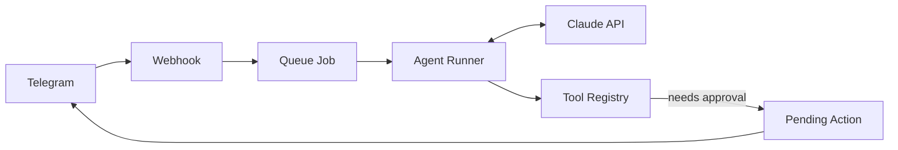

# AI Personal Assistant

A Telegram-based personal assistant built with Laravel and the Claude API.
It understands text and voice messages and manages calendar events and email drafts,
**only after explicit human approval**.


## Architecture



## Status

Work in progress. See the roadmap in the project milestones.

## Development

Requires Docker (Laravel Sail).

```bash
./vendor/bin/sail up -d
./vendor/bin/sail composer ci
```

## License

MIT
